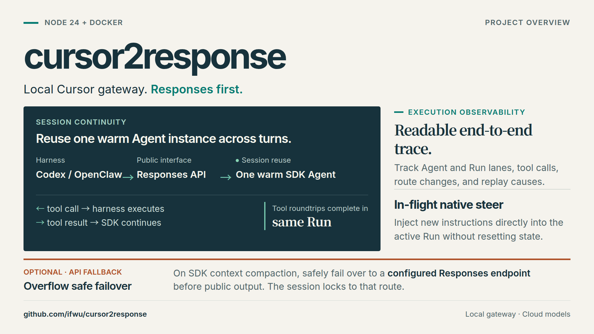
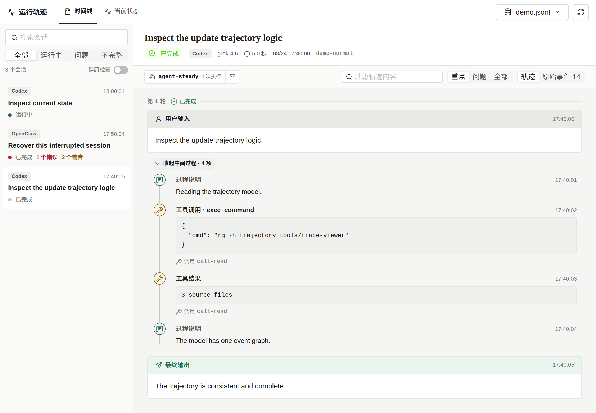
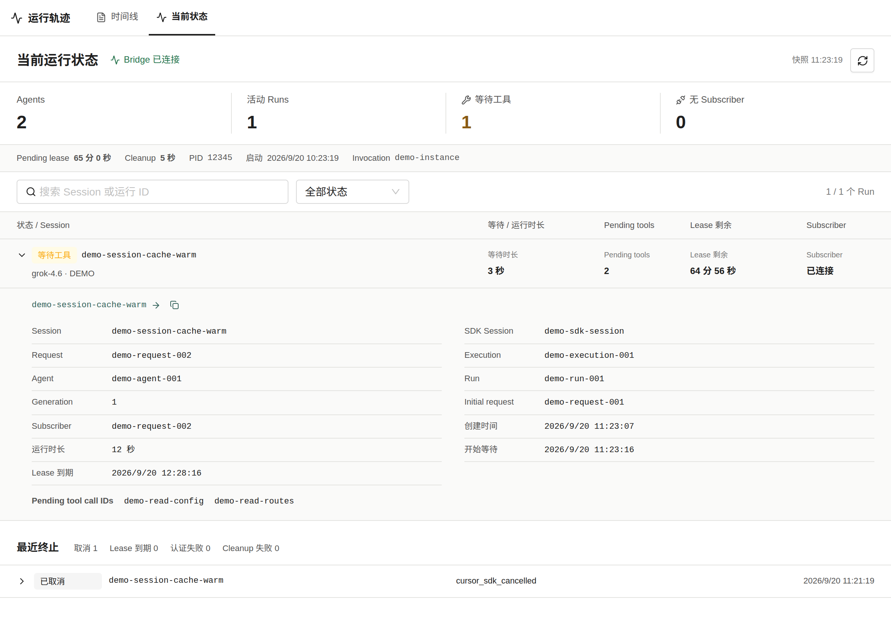
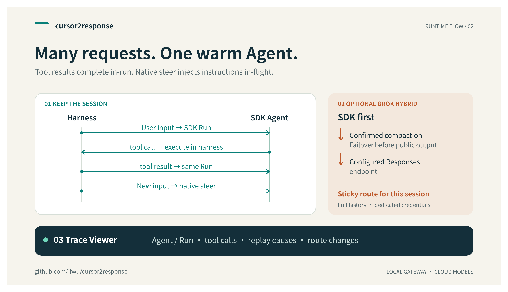

# cursor2response

**Keep Cursor conversations warm. Continue tool calls in the same Run. See what happened.**

English · [简体中文](README.zh-CN.md)

A local Cursor SDK gateway built for **Codex and OpenClaw**, focused on the OpenAI Responses API, in-run tool continuation, and transparent execution tracing.



The gateway runs locally; model inference relies on Cursor services and requires your own Cursor API key. Independently maintained and not an official Cursor product.

## Quick start

Prerequisites: Docker Engine and Docker Compose.

```bash
git clone https://github.com/ifwu/cursor2response.git
cd cursor2response
cp .env.example .env
openssl rand -hex 32
```

Set `CURSOR_SDK_BRIDGE_TOKEN` in `.env` to the generated random string (authenticates internal communication between Sidecar and Bridge). Clients can provide their own Cursor key per request, or you can optionally set `CURSOR_API_KEY` in `.env` as a single-user default.

```bash
docker compose up -d --build
docker compose ps
curl --fail http://127.0.0.1:6718/health
curl --fail http://127.0.0.1:8100/health
```

| Service | Address | Accessibility |
| --- | --- | --- |
| API Base URL | `http://127.0.0.1:6718/v1` | Loopback only (127.0.0.1) |
| Trace Viewer | `http://127.0.0.1:8100` | Loopback only (127.0.0.1) |
| SDK Bridge | Internal port | Compose network only |

List models available to your account:

```bash
curl --fail http://127.0.0.1:6718/v1/models \
  -H "Authorization: Bearer $CURSOR_API_KEY"
```

> **Security Note**: Published ports bind strictly to `127.0.0.1` by default. The Trace Viewer has no built-in authentication—do not expose it to untrusted networks. If a default `CURSOR_API_KEY` is set in `.env`, any client reaching the API can consume its quota. For configuration, updates, and volume backups, see the [local deployment guide](docs/runbooks/local-deployment.md).

If Cursor services require an outbound proxy, configure the standard HTTP(S) proxy variables in `.env`. Docker host addressing, HTTP/1.1 fallback, custom CA, and verification limits are covered in the [network proxy guide](docs/runbooks/local-deployment.md#network-proxy).

## Connect a client

Replace `MODEL_ID` below with a model ID returned by `/v1/models`.

Ensure `CURSOR_API_KEY` is set in your client's shell environment:

```bash
export CURSOR_API_KEY="your-cursor-api-key"
```

### Codex

Add this configuration to `~/.codex/config.toml` (place root settings before any `[table]` headers):

```toml
model_provider = "cursor2response"
model = "MODEL_ID"

[model_providers.cursor2response]
name = "cursor2response"
base_url = "http://127.0.0.1:6718/v1"
wire_api = "responses"
env_key = "CURSOR_API_KEY"
```

Run `codex` directly from the terminal without creating a named profile.

### OpenClaw

Merge this into `~/.openclaw/openclaw.json`:

```json5
{
  models: {
    mode: "merge",
    providers: {
      cursor2response: {
        baseUrl: "http://127.0.0.1:6718/v1",
        apiKey: "${CURSOR_API_KEY}",
        api: "openai-responses",
        models: [{ id: "MODEL_ID", name: "Cursor" }],
      },
    },
  },
  agents: {
    defaults: {
      model: { primary: "cursor2response/MODEL_ID" },
    },
  },
}
```

> **Tip**: If you configure an `agents.defaults.models` allowlist, add `cursor2response/MODEL_ID` to it. Configure `contextWindow` and `agents.defaults.contextTokens` according to your model, as detailed in [context budgets](docs/specs/api-fallback.md#client-context-budgets).

### Claude Code (compatibility mode)

Launch with the local base URL (without `/v1`):

```bash
ANTHROPIC_BASE_URL=http://127.0.0.1:6718 \
ANTHROPIC_API_KEY="$CURSOR_API_KEY" \
claude --model MODEL_ID
```

This uses the best-effort Anthropic Messages adapter. Check `/status` inside Claude Code to verify endpoint connectivity; see [Claude Code gateway configuration](https://code.claude.com/docs/en/llm-gateway-connect) for persistent setups.

## Execution tracing

The Trace Viewer correlates requests, Agent lanes, SDK Runs, tool activity, and routing decisions across a session into a single timeline, making context reuse and replays immediately visible without manual log hunting.



Recognized Codex and OpenClaw harness wrappers are collapsed into secondary items, keeping user intents and tool interactions front and center.

Switch to the Runtime tab to inspect in-memory Bridge state, including active Agents, parked Runs, and lease status:



Screenshots use synthetic demo data. For session inspection and live log workflows, see the [Trace Viewer guide](docs/runbooks/trace-viewer.md).

## Capabilities

| Capability | Summary |
| --- | --- |
| **Session reuse** | Follow-up turns reuse the SDK Agent, sending only the missing suffix to maximize provider prompt-cache hits. |
| **In-run tool continuation** | Tool results settle pending callbacks on the active SDK Run, keeping the internal agent loop intact. |
| **Native steering** | Inject new instructions into an in-progress Run via `Run.steer()` with ordered handling and delivery receipts. |
| **Trace Viewer** | Local visual interface to inspect session history, context replays, tool latencies, and runtime ownership. |
| **Context-overflow fallback** | Opt-in `cursor-relay` routes to a configured Responses endpoint when SDK context compaction occurs. |
| **Native system prompt** | Pass `system_prompt` on Responses requests to replace or strip the default Cursor system prompt. |
| **Clean execution boundaries** | Intermediate commentary and final answers remain distinct; cancellations target the owning execution; clean Agents resume across restarts. |



### How it works

- **Decoupled Requests and Runs**: An HTTP request is not an SDK Run. Multiple tool round trips complete inside the same active Run, avoiding redundant context reconstruction.
- **Multi-turn Reuse and Steering**: Subsequent user turns can start a new Run on the existing Agent, or inject prompt updates into an active Run via native steering.
- **Prefix-matched Replays**: Reuse relies on an exact hash prefix match of conversation history. If client-side compaction or edits diverge from the accepted transcript, the gateway safely performs a full replay.
- **API fallback**: Select `cursor-relay` and configure `C2R_PRIMARY_MODEL`, `C2R_FALLBACK_BASE_URL`, `C2R_FALLBACK_API_KEY` and `C2R_FALLBACK_MODEL`. Confirmed SDK compaction marks the session for fallback; the current request is recovered only before public output and after confirmed SDK cleanup. See [setup](docs/runbooks/local-deployment.md#optional-api-fallback-route) and the [routing contract](docs/specs/api-fallback.md).
- **Native System Prompt Override**: Pass a non-empty `system_prompt` string to replace the Cursor system prompt, or pass `false` for the SDK default (requires account support). See the [system prompt contract](docs/specs/responses-agent-context-affinity.md#native-system-prompt).

## Why this project exists

This project originated as a fork of [NGLSG/cursor2api](https://github.com/NGLSG/cursor2api) to address the core issue discussed in [upstream issue #1](https://github.com/NGLSG/Cursor2API/issues/1): preventing SDK context reconstruction on every turn and keeping tool interactions inside a single execution lifecycle.

Through intensive real-world use with Codex and OpenClaw, it evolved to incorporate in-run tool continuation, native steering, cancellation controls, strict transcript prefix matching, and full-chain trace visualization—becoming an independent Responses gateway with dedicated runtime and protocol specifications.

## Compatibility and limits

- **Primary API:** `/v1/responses`, including streaming, client tools, tool-result continuation, and session affinity. Codex and OpenClaw serve as the main acceptance paths.
- **Best effort:** `/v1/chat/completions`, `/v1/messages`, and `/v1/messages/count_tokens`. These endpoints do not claim full protocol conformance.
- **Runtime:** Source execution supports Node.js 24 or later (verified on Node 24 and 26). The Linux amd64 Docker image stays pinned to Node.js 24 LTS for a stable deployment baseline.
- **Conversation history:** Clients must preserve and send the full public history (including tool calls, results, and phases); `previous_response_id` does not replace that history.
- **Restart behavior:** Compose volumes persist SDK checkpoints and Bridge state. Cleanly completed Agents can resume after restart; active Runs and pending tool callbacks do not survive process replacement.
- **Context accounting:** Token counts are character-based estimates, not authoritative SDK context measurements. A successful single prompt does not establish a safe multi-turn context ceiling.
- **Trace privacy:** Logs and trace files contain prompt content, tool arguments, and outputs. Review and sanitize artifacts before sharing.

See [protocol support](docs/specs/protocol-support.md) for detailed contracts.

## Run from source

To run directly with Node.js 24 or later and npm:

```bash
npm ci
npm run build
node server.mjs start
node server.mjs status
```

`server.mjs` loads the repository `.env` before starting a lightweight API + Bridge local daemon. Internal tokens and process states are stored in `~/.cursor2response`. Stop the daemon with `node server.mjs stop`.

Once started, list available models in a clean terminal table:

```bash
node server.mjs models
node server.mjs models --json
```

> **Note**: A standalone Trace Viewer cannot discover the dynamic token generated by `server.mjs`. To run the full stack (API + Bridge + Viewer), use Docker Compose or follow the [three-terminal source setup](docs/runbooks/local-deployment.md#direct-source-execution).

## Development and tests

```bash
npm run typecheck
npm test
npm run test:operations
npm run trace:viewer:typecheck
npm run trace:viewer:test
npm run trace:viewer:build
```

Start with the [documentation index](docs/README.md) and [repository instructions](AGENTS.md). Protocol changes should update the relevant specification and regression coverage together.

## Credits

- [standardagents/composer-api](https://github.com/standardagents/composer-api) — the original MIT-licensed project on which this lineage is based.
- [NGLSG/cursor2api](https://github.com/NGLSG/cursor2api) — our direct upstream, which extended the original project with sidecar deployment, Responses / Messages / Chat support, and client integrations.
- `@cursor/sdk` and Cursor Composer models — the SDK and model capabilities behind the gateway.
- [LINUX DO](https://linux.do) — a community for discussion and exchange.

cursor2response is independently maintained and builds on these projects and contributions.

## License

Source is available under the [MIT license](LICENSE), retaining the original Standard Agents copyright notice.

Dependencies retain their own licenses; `@cursor/sdk` is not covered by this repository's MIT license. See [third-party notices](THIRD_PARTY_NOTICES.md).
