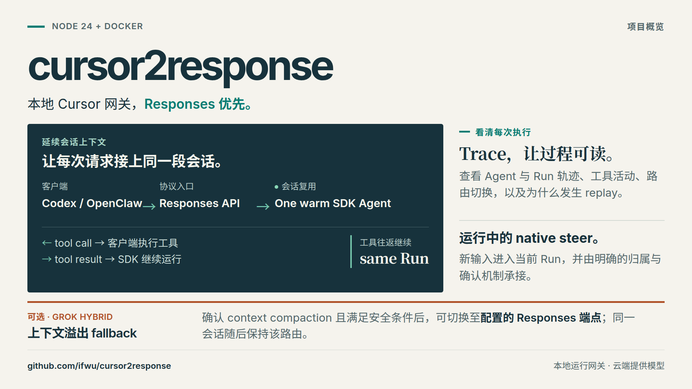
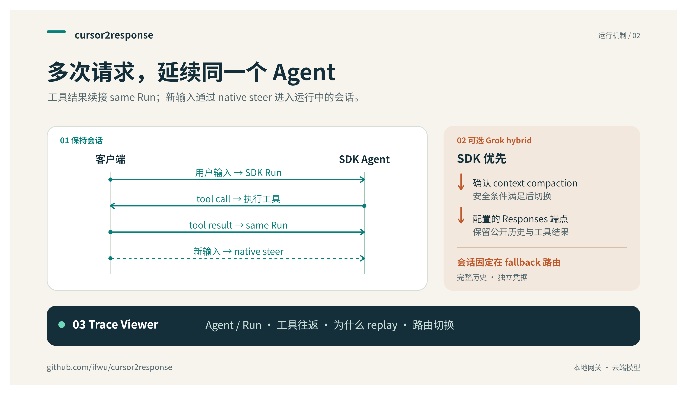

# cursor2response

**复用 Cursor 会话，在同一个 Run 中续接工具调用，让执行过程清晰可见。**

[English](README.md) · 简体中文

面向 OpenAI Responses API 客户端的本地 Cursor SDK 网关，内置 Trace Viewer。经过 **Codex 和 OpenClaw** 日常使用中的持续验证，重点解决会话复用、工具续接和执行过程可观测性。



网关运行在本机，模型推理仍使用 Cursor 服务，需要你自己的 Cursor API Key。本项目独立维护，非 Cursor 官方产品。

## 快速开始

安装 Docker Engine 和 Docker Compose，然后执行：

```bash
git clone https://github.com/ifwu/cursor2response.git
cd cursor2response
cp .env.example .env
openssl rand -hex 32
```

将生成的随机值填入 `.env` 的 `CURSOR_SDK_BRIDGE_TOKEN`，用于内部 Bridge 调用鉴权；它与 Cursor API Key 是两个独立凭据。客户端可以自行提供 Cursor Key，也可以在 `.env` 中设置 `CURSOR_API_KEY`，作为单用户部署的默认 Key。

```bash
docker compose up -d --build
docker compose ps
curl --fail http://127.0.0.1:6718/health
curl --fail http://127.0.0.1:8100/health
```

| 组件 | 地址 |
| --- | --- |
| API base URL | `http://127.0.0.1:6718/v1` |
| Trace Viewer | `http://127.0.0.1:8100` |
| SDK Bridge | 仅 Compose 内部网络可访问 |

在客户端中填写上述 API base URL、你的 Cursor API Key，选择 **Responses** 模式，并使用 `/v1/models` 返回的 model ID：

```bash
curl --fail http://127.0.0.1:6718/v1/models \
  -H "Authorization: Bearer $CURSOR_API_KEY"
```

两个对外端口默认只绑定 localhost。请保管好 `.env`。Viewer 没有用户鉴权，可能展示对话内容；如果配置了默认 Cursor Key，能够访问 API 的调用者就能使用该凭据。

配置、源码运行、升级和备份见[本地部署指南](docs/runbooks/local-deployment.md)。镜像由源码在本地构建，项目不提供托管网关或预构建发布镜像。

## 看清一次会话的执行过程

Trace Viewer 将同一 session 的请求、Agent lanes、SDK Runs、工具调用和路由变化串起来，直接查看上下文复用、replay 和工具续接，无需逐条拼接原始日志。


Runtime 页面从 Bridge 查询当前 Agent 和待处理任务。历史 trace 用来解释已经发生的过程，runtime snapshot 用来确认此刻仍在运行的状态。


截图使用合成演示数据。实时会话和 trace 检查方法见 [Trace Viewer 指南](docs/runbooks/trace-viewer.md)。

## 主要特性

| 能力 | 实际作用 |
| --- | --- |
| **会话复用** | 兼容的后续轮次复用 SDK Agent，只发送缺失的输入后缀，为 prompt cache 复用保留条件。 |
| **同一 Run 内工具续接** | 后续 HTTP 请求送回的工具结果直接完成原 SDK Run 的回调，保持 SDK agent loop 连续。 |
| **Native steer** | 符合条件的新指令通过 `Run.steer()` 进入正在执行的 Run，并按顺序处理、确认送达。 |
| **Trace Viewer** | 在本地页面查看会话历史、工具活动、上下文 replay、provider 切换和当前 runtime 归属。 |
| **上下文溢出 fallback** | 显式启用 `grok-hybrid` 后，确认 SDK context compaction 时可转到配置的 OpenAI-compatible Responses endpoint 继续。 |
| **明确的执行边界** | 保留 assistant commentary 与 final 阶段；取消操作指向所属执行；干净结束的 Agent 可在重启后恢复。 |



一次 HTTP 请求不等于一次 SDK Run：同一个 Run 可以跨越多轮工具请求。后续用户轮次可以在原 Agent 上开启新 Run，也可以 steer 符合条件的活跃执行。复用需要稳定且兼容的 session identity 和对话历史；明确的恢复边界仍可能触发完整 replay。缓存行为由 provider 决定，项目不承诺固定命中率。

Fallback 有明确范围：选择 `grok-hybrid` 或 `grok-hybrid-fast` 并配置 provider 后才会启用。只有确认 SDK context compaction 才触发，普通错误不会触发。当前请求立即 fallback 还需要确认清理完成且尚未输出公开内容，后续请求则沿已记录的路由继续。详见[路由契约](docs/specs/grok-hybrid.md)。

## 项目缘起

本项目源于 [NGLSG/cursor2api](https://github.com/NGLSG/cursor2api) 的 fork，起因是[上游 issue #1](https://github.com/NGLSG/Cursor2API/issues/1) 中的缓存命中与会话复用问题。最初的目标是避免每次客户端请求都重建 SDK 上下文，并让工具往返留在 SDK 原有执行中。

随后在 Codex 和 OpenClaw 中持续自用和实证验证，逐步完善了工具续接、steering、取消、transcript 对齐和 trace 跟踪。项目在维护者的日常工作流中稳定下来后，作为以 Responses 为主、有独立 runtime 和协议契约的项目开源分享。

## 兼容范围与边界

- **主要 API：** `/v1/responses`，包括流式响应、客户端工具、工具结果续接和 session affinity。Codex 与 OpenClaw 是主要真实客户端验收路径。
- **Best effort：** `/v1/chat/completions`、`/v1/messages` 和 `/v1/messages/count_tokens`，不声明完整协议兼容。
- **Runtime：** 所有服务统一使用 Node.js 24 LTS，支持本地 Docker Compose 或源码运行。Docker 整套运行路径已在 Linux amd64 验证，其他平台尚未验收。
- **对话历史：** 客户端需保留要求的公开历史，包括工具调用、结果和 assistant phases；`previous_response_id` 不能代替这些历史。
- **重启行为：** Compose 持久化 SDK checkpoints 和 Bridge 状态；干净结束的 Agent 可以恢复，活跃 Run 和待返回的工具回调不会跨进程重启保留。`docker compose down` 保留 volumes，`docker compose down -v` 会删除它们。
- **上下文计量：** token 估算不是权威 SDK context 测量，单次长 prompt 成功不能证明多轮对话的安全上下文上限。
- **Trace 隐私：** 日志与状态可能包含 prompt、工具参数及结果，分享前需检查并脱敏。

具体兼容范围见[协议支持说明](docs/specs/protocol-support.md)。

## 从源码运行

安装 Node.js 24 LTS 和 npm 后执行：

```bash
npm ci
npm run build
node server.mjs start
node server.mjs status
```

Launcher 在 loopback 启动 API 与 Bridge，生成内部 token，并将进程状态和日志放在 `~/.cursor2response`。使用 `node server.mjs stop` 停止。需要同时运行 Viewer 并共享 trace 日志时，按[源码部署说明](docs/runbooks/local-deployment.md#direct-source-execution)配置。

## 开发与文档

```bash
npm run typecheck
npm test
npm run test:operations
npm run trace:viewer:typecheck
npm run trace:viewer:test
npm run trace:viewer:build
```

从[文档索引](docs/README.md)和[仓库约定](AGENTS.md)开始。协议变更应同步更新对应 spec 和回归覆盖。

## 许可与来源

项目源码采用 [MIT license](LICENSE)，保留原 Standard Agents 版权声明。项目派生自 [NGLSG/cursor2api](https://github.com/NGLSG/cursor2api)，现独立维护。

依赖保留各自许可；`@cursor/sdk` 不适用本仓库的 MIT license。详见[第三方声明](THIRD_PARTY_NOTICES.md)。
